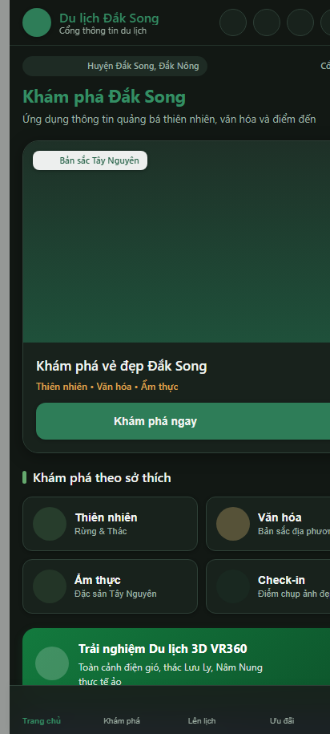
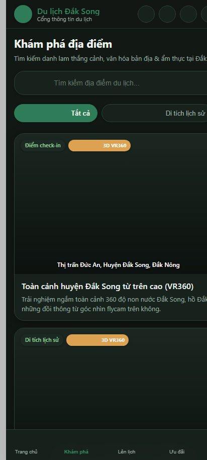
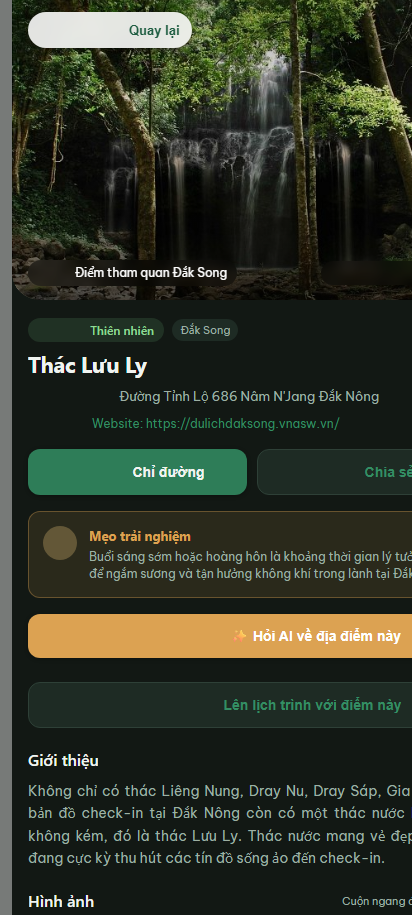
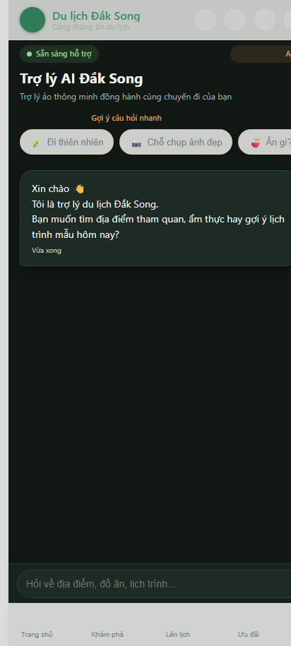
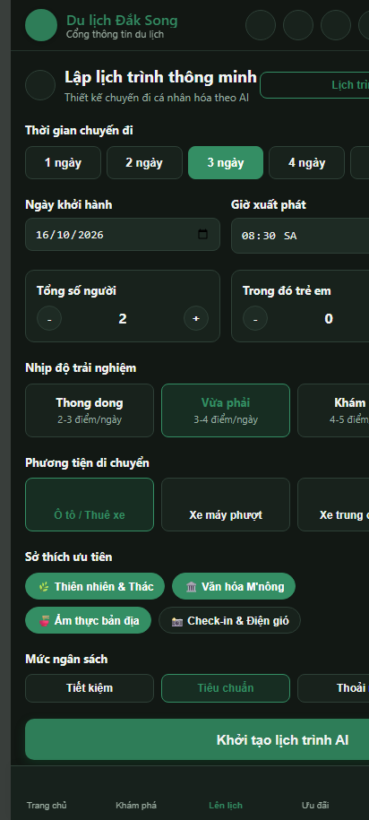
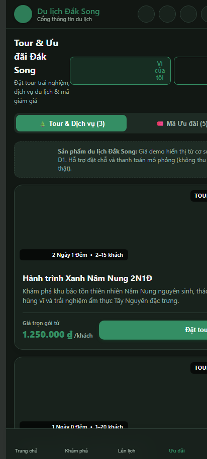
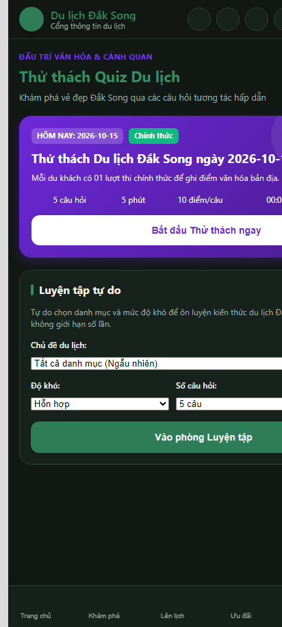
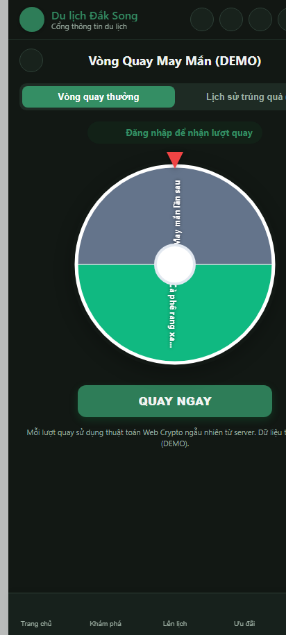
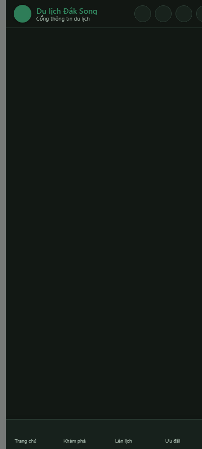
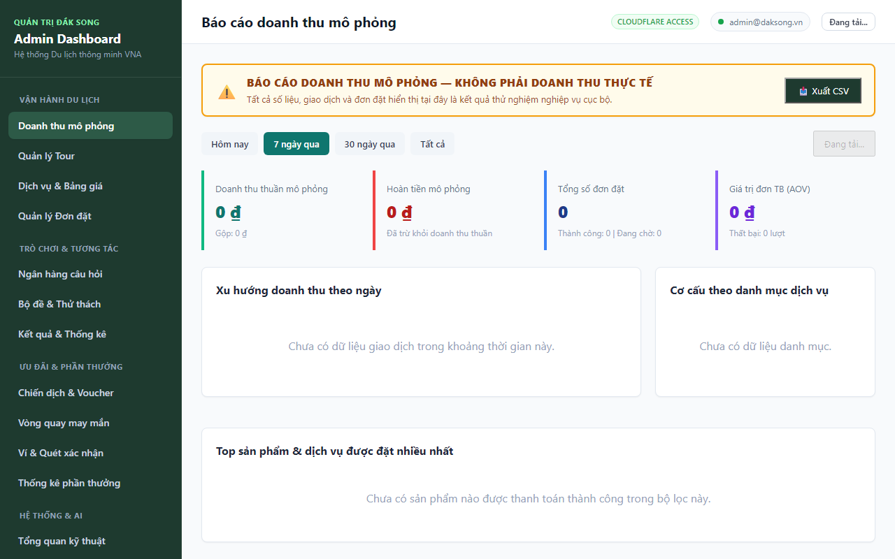

# VNA Đắk Song — Cổng Thông Tin & Trợ Lý Du Lịch Thông Minh

Hệ sinh thái nền tảng số hỗ trợ phát triển du lịch huyện Đắk Song (Đắk Nông) do VNA phát triển, bao gồm: **Zalo Mini App & Web Mobile cho du khách**, **Trợ lý ảo AI Chatbot**, **Lập lịch trình thông minh**, **Hệ thống đặt Tour & Voucher**, **Trắc nghiệm Tourism Quiz & Vòng quay may mắn**, cùng **Bảng điều khiển quản trị trung tâm (Admin Dashboard Console)**.

---

## 1. Kiến trúc hệ thống (System Architecture)

```text
┌─────────────────────────────────────────────────────────────────────────────┐
│                             CLIENT LAYER                                    │
│  ┌───────────────────────────────┐     ┌─────────────────────────────────┐  │
│  │  Tourist Zalo Mini App & Web  │     │     Admin Dashboard Console     │  │
│  │   (React 18 + Vite + zaui)    │     │      (React 18 + Tailwind)      │  │
│  │   http://127.0.0.1:5173       │     │      http://localhost:3001      │  │
│  │   vna-dak-song-travel.pages   │     │      vna-dak-song-admin.pages   │  │
│  └───────────────┬───────────────┘     └────────────────┬────────────────┘  │
└──────────────────┼──────────────────────────────────────┼───────────────────┘
                   │ HTTPS REST / WebSockets              │
                   ▼                                      ▼
┌─────────────────────────────────────────────────────────────────────────────┐
│                           BACKEND WORKER EDGE                               │
│                Cloudflare Worker (vna-dak-song-demo.workers.dev)            │
│                            http://127.0.0.1:8788                            │
│  ┌───────────────────────┐ ┌───────────────────────┐ ┌───────────────────┐  │
│  │ Identity & Auth (OTP) │ │ Travel Planner Engine │ │ Tour Booking CAS  │  │
│  └───────────────────────┘ └───────────────────────┘ └───────────────────┘  │
│  ┌───────────────────────┐ ┌───────────────────────┐ ┌───────────────────┐  │
│  │ Tourism Quiz Engine   │ │ Lucky Spin & Wallet   │ │ AI Reasoning Hub  │  │
│  └───────────────────────┘ └───────────────────────┘ └───────────────────┘  │
└──────────────────┬───────────────────┬───────────────────┬──────────────────┘
                   │                   │                   │
                   ▼                   ▼                   ▼
        ┌─────────────────────┐ ┌─────────────┐ ┌─────────────────────┐
        │ Cloudflare D1 (SQL) │ │  AI Models  │ │ Gmail SMTP (TLS 465)│
        │ 15 Migrations       │ │ 9router/Gem │ │ OTP Verification    │
        └─────────────────────┘ └─────────────┘ └─────────────────────┘
```

---

## 2. Tính năng tiêu biểu & Hình ảnh minh họa (Features & Screenshots)

### 2.1. Trang chủ Du lịch Đắk Song
Giao diện phong cách **Eco Modern**, hỗ trợ Dark/Light mode, tích hợp cẩm nang văn hóa, các danh thắng tiêu biểu và lối tắt tiện ích.



---

### 2.2. Khám phá & Chi tiết địa danh (3D VR360)
Danh mục điểm đến đa dạng (Thiên nhiên, Di tích, Ẩm thực, Check-in). Xem ảnh toàn cảnh flycam, chỉ đường GPS và trải nghiệm không gian 3D VR360.

| Khám phá danh lam thắng cảnh | Trang chi tiết địa danh (Thác Lưu Ly) |
| :---: | :---: |
|  |  |

---

### 2.3. Trợ lý ảo AI & Quá trình suy luận minh bạch
Trợ lý AI Đắk Song phản hồi súc tích, đính kèm thẻ địa điểm tương tác, tự động gợi ý lịch trình hoặc thử thách câu đố. Tích hợp **Hoạt họa suy nghĩ** và **Mục mở/gập xem các bước suy luận logic** từ dữ liệu địa phương.



---

### 2.4. Lập lịch trình thông minh (AI Travel Planner)
Tự động cấu trúc chuyến đi từ 1 đến 7 ngày, tối ưu hóa điểm dừng chân theo nhịp độ (Thong thả / Cân bằng / Khám phá nhiều), tích hợp khóa lạc quan (`optimistic_lock_guard`) chống xung đột khi lưu dữ liệu.



---

### 2.5. Tour du lịch Đắk Song trọn gói & Đặt tour
Danh mục các gói tour trải nghiệm nguyên sinh Nâm Nung, đồi thông, rẫy cà phê, hồ tiêu. Tính toán báo giá tức thời, sổ cái hoàn tiền bất biến và thanh toán thử nghiệm chuẩn hóa SafeInteger.



---

### 2.6. Thử thách kiến thức Tourism Quiz
Hệ thống câu đố trắc nghiệm văn hóa & lịch sử Đắk Song do máy chủ chấm điểm (Server-authoritative), chống gian lận, có chế độ Daily Challenge giới hạn theo khung giờ Việt Nam (+07:00).



---

### 2.7. Vòng quay may mắn & Ví Voucher du lịch
Mini-game Vòng quay may mắn (Lucky Spin) nhận lượt quay miễn phí mỗi ngày hoặc khi hoàn thành bài thi Quiz. Trúng thưởng mã voucher ưu đãi ẩm thực, lưu trú, tự động lưu vào Ví voucher người dùng.

| Vòng quay may mắn Lucky Spin | Ví Voucher & Đổi quà |
| :---: | :---: |
|  |  |

---

### 2.8. Trung tâm quản trị Admin Console
Trang quản trị toàn diện: Thống kê doanh thu, quản lý danh mục địa điểm, ngân hàng câu hỏi Quiz, cấu hình tỷ lệ trúng thưởng Vòng quay may mắn, giám sát bảo mật và quản lý hồ sơ AI runtime.



---

## 3. Cấu trúc thư mục Monorepo (Workspace Tree)

```text
VNA_Chat-Bot-for-Dak-Song-prv/
├── miniapp/                      # Ứng dụng Du khách (Zalo Mini App & Web Mobile)
│   ├── src/
│   │   ├── components/           # UI Components (Layout, Modals, Checkout, Auth, Cards)
│   │   ├── context/              # AppContext, AuthContext (Session, Token, Preferences)
│   │   ├── pages/                # Home, Explore, Detail, Chat, Planner, Vouchers, Spin, Quiz
│   │   ├── services/             # API Client, Auth SDK, Zalo Bridge
│   │   ├── types/                # TypeScript Interfaces & Contracts
│   │   └── app.tsx               # Entrypoint & Router điều hướng kép
│   ├── app-config.json           # Cấu hình Zalo Mini App
│   └── package.json
│
├── worker/                       # Backend Cloudflare Worker REST API
│   ├── migrations/               # 15 file migration SQL đồng bộ Cloudflare D1
│   ├── src/
│   │   ├── prompts/              # Prompt chuẩn trợ lý du lịch & AI reasoning
│   │   ├── repositories/         # Lớp thao tác dữ liệu SQLite D1
│   │   ├── routes/               # Bộ điều hướng Auth, Chat, Tours, Quiz, Rewards, Admin
│   │   ├── services/             # Nghiệp vụ: Booking, Quiz, Reward, Planner, Email SMTP
│   │   ├── utils/                # Rate limiter, CORS headers, Error handling
│   │   └── index.ts              # Worker Fetch Dispatcher
│   ├── test/                     # Bộ 191 kiểm thử đơn vị & tích hợp Backend
│   ├── wrangler.demo.jsonc       # Cấu hình triển khai Cloudflare Worker Staging
│   └── package.json
│
├── admin/                        # Bảng điều khiển quản trị (Admin Console)
│   ├── src/
│   │   ├── pages/                # Revenue, Tours, Services, Bookings, Quiz, Rewards, Logs...
│   │   ├── services/             # Admin API Client & Token Management
│   │   └── types/                # Admin Shared Contracts
│   ├── test/                     # Bộ 14 kiểm thử UI/UX & Fail-closed Admin
│   └── package.json
│
├── docs/                         # Báo cáo kỹ thuật, Runbook & Ảnh minh họa (screenshots)
└── package.json                  # Root Monorepo Scripts (Typecheck, Test, Build)
```

---

## 4. Hướng dẫn khởi chạy Localhost (Quick Start)

### 4.1. Cài đặt toàn bộ dependencies
Tại thư mục gốc dự án:
```bash
npm install
```

### 4.2. Khởi chạy 3 Workspace cục bộ
- **Terminal 1 — Backend Worker (Port 8788):**
  ```bash
  npm run dev:worker
  ```
- **Terminal 2 — Tourist Mini App (Port 5173):**
  ```bash
  npm run dev:miniapp
  ```
- **Terminal 3 — Admin Dashboard Console (Port 3001):**
  ```bash
  npm run dev:admin
  ```

### 4.3. Kiểm thử & Đóng gói (Testing & Verification Matrix)
Toàn bộ dự án tuân thủ tiêu chuẩn chất lượng nghiêm ngặt (244/244 Tests PASS, 0 Warning TypeScript):
```bash
# Kiểm tra TypeScript toàn bộ 3 workspace
npm run typecheck

# Chạy toàn bộ 244 test suite (Worker + Mini App + Admin)
npm run test

# Đóng gói Production build cả 3 workspace
npm run build
```

---

## 5. Triển khai Cloudflare & Zalo Mini App (Deployment)

### 5.1. Đồng bộ cơ sở dữ liệu Cloudflare D1
```bash
cd worker
npx wrangler d1 migrations apply dak-song-db-staging --remote --config wrangler.demo.jsonc
```

### 5.2. Triển khai Backend Cloudflare Worker
```bash
cd worker
npx wrangler deploy --config wrangler.demo.jsonc
```

### 5.3. Triển khai Web Pages lên Cloudflare
- **Admin Dashboard**: `https://vna-dak-song-admin.pages.dev`
- **Tourist Web App**: `https://vna-dak-song-travel.pages.dev`

### 5.4. Đóng gói bản thử nghiệm Zalo Mini App
```bash
cd miniapp
npx zmp-cli deploy -p -t -e -m "Release"
```
*(Quét mã QR do CLI sinh ra trên ứng dụng Zalo điện thoại để mở bản thử nghiệm trực tiếp).*
